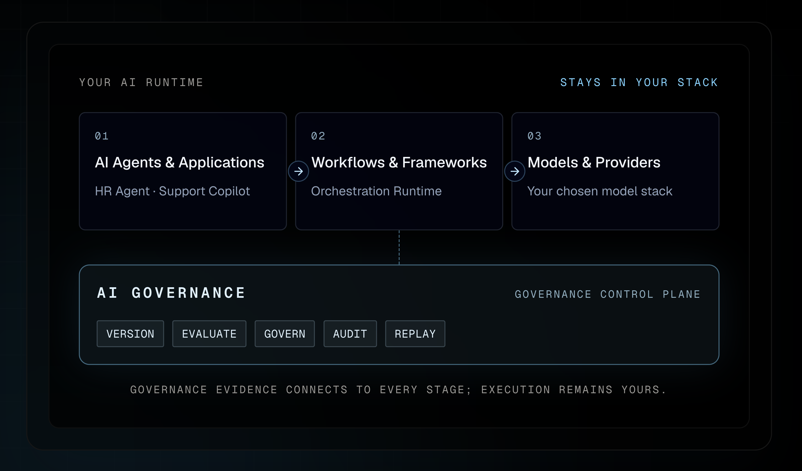

# AIGP - AI Governance Control Platform

## Govern AI Actions. Preserve Execution Evidence. Investigate Outcomes.

AIGP OSS is an open-source governance control platform for AI systems and agents.
It establishes authority for consequential actions, records bounded execution
evidence, evaluates behaviour, and preserves the lineage needed to investigate
an outcome later.

It sits beside—not in place of—your agent framework, application, model
provider, workflow engine, or deployment platform. AIGP does not host models,
execute application business operations, own external runtime state, or
coordinate external transactions.



[Website](https://governance.bhanuj.ai) ·
[Documentation](https://governance.bhanuj.ai/docs) ·
[API reference](https://governance.bhanuj.ai/reference/api) ·
[Tutorials](https://governance.bhanuj.ai/tutorials) ·
[Run locally](#quickstart-local)

> **Scope notice:** this repository contains the OSS control plane. Enterprise
> capabilities remain under active development and are not represented here as
> OSS functionality.

## Why a governance control platform?

An agent log can show that a tool was called, an access-control check can say a
caller was allowed, and an evaluation can score an outcome. On their own, those
records do not answer the governance questions around a consequential action:

- Who gave this runtime limited authority for this exact operation?
- Was the proposed action authorized immediately before it was attempted?
- What outcome did the authenticated runtime report, including uncertainty?
- Which versioned assets, policies, evaluations, and decisions influenced the
  result?
- Is there sufficient isolated, versioned evidence to attempt a controlled
  replay—and did a specific evidence intervention change the outcome?

AIGP connects those concerns through tenant-scoped, versioned contracts and
durable lineage. It does not infer that an authorization caused an execution,
or that a runtime report independently proves an external effect.

## Governance Lifecycle


1. **Identity and Trusted Delegation.** An authorized issuer creates a limited,
   immutable delegation for a canonical execution, runtime actor, action,
   resource, and expiry.
2. **Authorization.** Immediately before a protected operation, the runtime
   asks AIGP for an `ALLOW` or `DENY` bound to the exact action, resource,
   delegation, and tool-argument digest.
3. **External Enforcement.** The runtime is the policy-enforcement point. It
   executes only a valid, unexpired `ALLOW`; AIGP never invokes the business
   operation.
4. **Execution Attestation.** The authenticated runtime appends bounded receipt
   evidence about the attempted outcome. It retains responsibility for its own
   idempotency, transactions, result retention, and recovery.
5. **Replay Eligibility.** A versioned manifest assesses whether frozen
   execution evidence, capability, and isolation declarations are sufficient
   for a safe replay attempt.
6. **Controlled Replay and Causal Audit.** A runtime-owned adapter resolves its
   private snapshot and runs an isolated counterfactual. AIGP records the
   resulting bounded evidence and lineage for causal investigation.

### Important Distinctions

| AIGP records or decides | AIGP does not claim or do |
| --- | --- |
| An authorization decision for one exact proposed action | Execute, retry, roll back, or transactionally coordinate the external operation |
| An authenticated runtime's bounded receipt attestation | Independently prove that an external mutation occurred |
| `UNREPORTED` when an `ALLOW` has no ingested receipt | Treat an absent receipt as proof that nothing happened |
| `UNKNOWN` when the runtime explicitly cannot determine the outcome | Automatically retry an operation with uncertain side effects |
| Replay eligibility from frozen evidence and isolation bindings | Guarantee that a currently deployed worker has the required adapter |
| An isolated controlled replay outcome | Reconstruct an arbitrary workflow, checkpoint, prompt, or private reasoning trace |
| Evidence sensitivity under a governed intervention | Access chain-of-thought or prove universal causation |

Read the contract details for [Runtime Action Authorization](docs/tutorials/runtime-action-authorization.md),
[execution receipts and recovery](docs/architecture/RUNTIME_ACTION_EXECUTION_RECEIPTS.md),
[replay manifests](docs/architecture/REPLAY_MANAGEMENT.md#replay-eligibility-manifest),
the [runtime replay adapter boundary](docs/architecture/RUNTIME_REPLAY_ADAPTER.md),
and [Causal Audit](docs/architecture/CAUSAL_AUDIT.md).

## OSS Capabilities

### Identity, Delegation, and Runtime Authorization

- Tenant-scoped authentication, RBAC, and server-derived tenant context.
- Immutable, policy-authorized delegation with bounded action/resource scope,
  expiry, and one-way revocation.
- `runtime-action-authorization/v2` decisions bound to an execution, actor,
  action, resource, delegation, argument digest, idempotency key, and bounded
  context.
- A fail-closed runtime pattern: service failures, expired decisions, binding
  mismatches, and denials block the protected operation.

The control plane is a decision service; it never accepts a caller's claimed
authority as a substitute for server-resolved delegation and policy. See
[Trusted Delegation](docs/tutorials/runtime-action-authorization.md#trusted-delegation)
and the [LangGraph authorization example](docs/tutorials/langgraph-runtime-action-authorization.md).

### Agent Execution Evidence & Recovery

- Append-only runtime authorization, tool-call, and execution-receipt evidence
  on the existing agent-execution lifecycle.
- Bounded receipt contracts containing identities, references, reason codes,
  and digests—not raw arguments, results, prompts, credentials, or error
  payloads.
- Idempotent duplicate delivery, conflict detection, immutable supersession of
  one `UNKNOWN` receipt, and historical receipt ingestion after an earlier
  authorization expires or delegation is revoked.
- Recovery semantics that require the runtime to reconcile against its own
  durable transaction or idempotency evidence without repeating uncertain work.

See [Runtime Action Execution Receipts](docs/architecture/RUNTIME_ACTION_EXECUTION_RECEIPTS.md).

### Evaluation, Experimentation, and Asset Governance

- Versioned prompt, model, dataset, and evaluation-provider registries.
- Experiment candidates, evaluation runs, rankings, leaderboards, comparisons,
  and drift analysis as governed evidence.
- Native OpenAI and Anthropic runtime connections plus OpenAI-compatible custom
  endpoints; provider configuration and secret references remain separate from
  immutable asset versions.
- Recommendations and governance decisions that remain distinct from model
  deployment.

See [Experiment Management](docs/architecture/EXPERIMENT_MANAGEMENT.md),
[producer integration](docs/tutorials/producer-integration.md), and the
[architecture decisions](docs/architecture/DECISIONS.md).

### Controlled Replay & Causal Audit

- Immutable replay requests and frozen replay configurations, with idempotent
  creation and explicit job lifecycle.
- Additive `replay-manifest/v1` eligibility assessments. A failed execution can
  be eligible when its evidence and isolation declarations are sufficient;
  a `SUCCEEDED` receipt alone is not enough.
- Versioned Evidence Intervention Policies and isolated counterfactual replay.
- Bounded outcome scoring, deterministic audit classification, and durable
  policy → intervention → replay → score → audit lineage.

Controlled replay is not an external-operation retry and must not perform
production side effects. See [Replay Management](docs/architecture/REPLAY_MANAGEMENT.md)
and [Causal Audit](docs/architecture/CAUSAL_AUDIT.md).

<table>
  <tr>
    <td width="50%"><br /><strong>Controlled Replay</strong> — apply one approved evidence intervention in runtime isolation and retain a bounded outcome.</td>
    <td width="50%"><br /><strong>Evidence-Aligned Finding</strong> — retain a reviewable conclusion with the intervention, replay, score, and audit lineage.</td>
  </tr>
</table>

### Knowledge Graph, Ontology, and Decision Lineage

- A governed ontology for assets, evidence, policies, executions, decisions,
  and their typed relationships.
- Decision evidence building, deterministic policy evaluation, auditable
  governance decisions, and ontology projection.
- Tenant-scoped graph queries and lineage views backed by the configured
  control-plane persistence.

See the [Governance Ontology](docs/architecture/GOVERNANCE_ONTOLOGY.md) and
[Decision architecture](docs/architecture/DECISIONS.md).

### Operations, Events, Observability, and Extensibility

- Durable asynchronous jobs for replay, evaluation, experiment, and related
  governance work, including leases, idempotent submission, retries, and
  cancellation boundaries.
- REST APIs, MCP interfaces, Studio, audit records, events, configuration, and
  SQLite/PostgreSQL reference persistence with optional Snowflake analytics
  persistence.
- A provider-neutral plugin registry that discovers public entry points rather
  than importing an Enterprise distribution.

See [Platform Architecture](docs/architecture/ARCHITECTURE.md),
[Extensibility](docs/architecture/EXTENSIBILITY.md), and the
[Plugin API](docs/architecture/PLUGIN_API.md).

## Architecture and Ownership


The control plane owns governance state and evidence contracts. The runtime
owns execution correctness and private replay material. The external
application owns its business data and transactional semantics. This division
keeps a receipt useful without misrepresenting it as independent proof, and
keeps controlled replay from becoming an application transaction coordinator.

For the complete plane-by-plane architecture, dependency direction, persistence
selection, and non-goals, see [Architecture](docs/architecture/ARCHITECTURE.md).

## Quickstart: Local

The Docker development stack starts Studio, the REST API, Keycloak, Neo4j,
SeaweedFS, MCP services, and the replay and ontology-sync workers. It uses
development-only identities and seeded demonstration data; do not reuse those
values in shared or production environments.

**Prerequisites:** Docker Desktop with Docker Compose v2. Install
[uv](https://docs.astral.sh/uv/) and Python 3.12+ as well if you plan to run
host tests or local Python processes.

```sh
git clone https://github.com/Bhanuj-AI/ai-governance-oss.git
cd ai-governance-oss

# Required local-development configuration; do not commit the generated files.
cp .env.platform.example .env.platform
cp keycloak-postgres/.env.keycloak.example keycloak-postgres/.env.keycloak
cp console/.env.local.example console/.env.studio

# Starts Keycloak, builds the platform where needed, and starts the OSS stack.
./servers.sh up
```

Open:

| Service | Address |
| --- | --- |
| Studio | http://localhost:3000 |
| REST API / OpenAPI | http://localhost:8000/docs |
| MCP OpenAPI | http://localhost:8001/docs |
| Neo4j Browser | http://localhost:7474 |
| SeaweedFS Filer | http://localhost:8888 |

Sign in to Studio as `studio` using the `AI_GOVERNANCE_STUDIO_PASSWORD` value
in `keycloak-postgres/.env.keycloak`. The first Docker build can take a few
minutes. Manage the stack with `./servers.sh ps`, `./servers.sh logs`, and
`./servers.sh down`; run `./servers.sh config` to render and validate its
Compose configuration before startup.

For a fuller local tour, including demo data, Studio, assets, evaluations, and
ontology lineage, follow the [End-to-End Local Tutorial](docs/tutorials/end-to-end-local.md).
For settings, authentication modes, persistence backends, and deployment
configuration, see [Configuration](docs/reference/CONFIGURATION.md).

## Framework integrations and Plugin API

AIGP OSS is framework-neutral. Integrations use the public plugin contracts and
the existing provider-neutral extension registry; the control plane does not
import framework-specific runtime implementations.

### LangGraph Reference Replay Adapter

The independently released [AIGP LangGraph Replay Adapter](https://github.com/Bhanuj-AI/aigp-langgraph-replay-adapter)
implements `langgraph/v1` using
[`bhanuj-governance-plugin-api==1.1.1`](packages/bhanuj-governance-plugin-api/README.md).
Install the tagged GitHub release—not a PyPI package—into the environment that
runs the replay worker:

```sh
python -m pip install \
  "aigp-langgraph-replay-adapter @ git+https://github.com/Bhanuj-AI/aigp-langgraph-replay-adapter.git@v0.1.0"
export AIGP_LANGGRAPH_REPLAY_SNAPSHOT_DB=/secure/runtime/langgraph-snapshots.db
```

The [`v0.1.0` release](https://github.com/Bhanuj-AI/aigp-langgraph-replay-adapter/releases/tag/v0.1.0)
is a **reference counterfactual executor**. It resolves a runtime-private
snapshot containing precomputed scores and runs an isolated graph to return a
bounded counterfactual outcome. It is not a generic LangGraph checkpoint or
workflow replay engine, does not invoke tools, and never opens or mutates the
original business database.

Adapter discovery is separate from evidence eligibility: an execution can have
an eligible replay manifest even if the current worker lacks the adapter. In
that case the replay fails explicitly as unavailable rather than silently
falling back. Read the [Runtime Replay Adapter Contract](docs/architecture/RUNTIME_REPLAY_ADAPTER.md)
and [Plugin Extension Guide](docs/architecture/PLUGIN_EXTENSION_GUIDE.md).

For a runnable banking scenario spanning authorization, receipts, recovery,
manifest eligibility, isolated replay, and causal lineage, use the advanced
[Execution Assurance Lab](https://github.com/Bhanuj-AI/labs/tree/main/agent-frameworks/langgraph/langgraph-execution-assurance-lab) in the separately maintained `Bhanuj-AI/labs`
repository. It is intentionally independent of the foundational LangGraph
runtime-authorization lab.

## Studio: Inspect Decisions and Lineage

Studio is an operator interface over the same tenant-scoped REST APIs used by
integrations. It renders persisted evidence and lineage; it does not make
governance decisions in the browser.

<table>
  <tr>
    <td width="50%"><br /><strong>Causal Audit</strong> — inspect governed interventions, controlled replays, outcomes, and classification.</td>
    <td width="50%"><br /><strong>Governance Decisions</strong> — inspect deterministic outcomes and their supporting evidence.</td>
  </tr>
  <tr>
    <td width="50%"><br /><strong>Decision Lineage</strong> — trace policies, evidence, and governed records behind an outcome.</td>
    <td width="50%"><br /><strong>Ontology Graph</strong> — explore governed entities and typed relationships.</td>
  </tr>
</table>

## Paths

| If you want to… | Start here |
| --- | --- |
| Run the OSS stack and explore Studio | [Quickstart](#quickstart-local) and the [End-to-End Local Tutorial](docs/tutorials/end-to-end-local.md) |
| Integrate a producer that reports governed assets or observations | [Producer Integration Guide](docs/tutorials/producer-integration.md) |
| Protect a consequential agent operation | [Runtime Action Authorization](docs/tutorials/runtime-action-authorization.md) |
| See a LangGraph protected-tool pattern | [LangGraph Runtime Action Authorization](docs/tutorials/langgraph-runtime-action-authorization.md) |
| Understand evidence, manifests, controlled replay, and causal investigation | [Governed Replay Walkthrough](docs/tutorials/governed-replay-walkthrough.md), [Replay Management](docs/architecture/REPLAY_MANAGEMENT.md), and [Causal Audit](docs/architecture/CAUSAL_AUDIT.md) |
| Build a plugin or provider extension | [Plugin API](docs/architecture/PLUGIN_API.md), [Plugin Extensions](docs/architecture/EXTENSIBILITY.md), and the [Plugin Extension Guide](docs/architecture/PLUGIN_EXTENSION_GUIDE.md) |
| Explore REST or MCP contracts | [REST API reference](docs/reference/REST_API.md), [MCP usage](docs/reference/MCP_USAGE.md), and local OpenAPI at http://localhost:8000/docs |
| Contribute to OSS | [CONTRIBUTING.md](CONTRIBUTING.md) and `./scripts/dev/preflight.sh` |

## Development and Contribution

For host development, install the locked Python environment and run focused
checks with the project tooling:

```sh
uv sync
uv run ruff check .
uv run pytest
```

Before opening a pull request, run the repository preflight. It checks the
working-tree patch, lint, relevant tests, and Studio type checks when needed;
it does not commit, push, or start Docker services.

```sh
./scripts/dev/preflight.sh
```

Read [CONTRIBUTING.md](CONTRIBUTING.md) for contribution scope, compatibility,
testing, documentation, and security expectations. Review
[Design Principles](docs/architecture/DESIGN_PRINCIPLES.md) before proposing a
cross-plane or extension-contract change.

## Reference Documentation

- [Architecture](docs/architecture/ARCHITECTURE.md)
- [Runtime Action Authorization](docs/tutorials/runtime-action-authorization.md)
- [Runtime Action Execution Receipts](docs/architecture/RUNTIME_ACTION_EXECUTION_RECEIPTS.md)
- [Replay Management](docs/architecture/REPLAY_MANAGEMENT.md)
- [Runtime Replay Adapter Contract](docs/architecture/RUNTIME_REPLAY_ADAPTER.md)
- [Causal Audit](docs/architecture/CAUSAL_AUDIT.md)
- [Governance Ontology](docs/architecture/GOVERNANCE_ONTOLOGY.md)
- [Experiment Management](docs/architecture/EXPERIMENT_MANAGEMENT.md)
- [Configuration](docs/reference/CONFIGURATION.md)
- [Public API reference maintenance](docs/maintenance/API_REFERENCE.md)
- [Roadmap](docs/roadmap/ROADMAP.md)

## License

Apache License 2.0. See [LICENSE](LICENSE).
