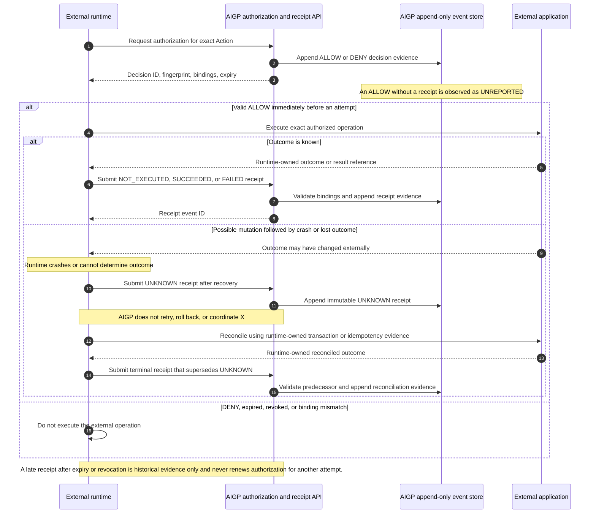

# Runtime Action Execution Receipts

## Purpose and Ownership

Runtime action authorization establishes whether an authenticated runtime may
attempt one exact operation.  It does not execute the operation and does not
prove that the runtime used the authorization integration.

An execution receipt is append-only, privacy-bounded evidence reported by the
authenticated runtime after that decision.  It binds a decision to the
runtime's reported terminal outcome.  A receipt proves only that the
authenticated runtime identity submitted this bounded attestation to AIGP; it
is not independent proof that an external mutation occurred.

The external runtime continues to own tool invocation, transactional
correctness, mutation idempotency, result retention, and recovery.  AIGP must
not retry, roll back, or coordinate an external operation.

## Receipt Contract

`runtime-action-execution-receipt/v1` is persisted as an append-only
`RUNTIME_ACTION_EXECUTION_RECEIPT` event on the existing `AgentExecution`.
Authenticated runtimes submit it to
`POST /api/v1/agent-executions/{execution_id}/runtime-action-receipts`; the
attester identity is taken from server-resolved tenant context, never the body.
It contains only bounded identifiers, references, and digests:

- authorization decision ID and immutable request fingerprint;
- action ID, runtime tool-call ID, and canonical tool-arguments digest;
- `NOT_EXECUTED`, `SUCCEEDED`, `FAILED`, or `UNKNOWN` terminal status;
- a bounded reason code, plus an optional result reference and SHA-256 digest;
- server-derived authenticated runtime identity and attestation timestamp; and
- an optional prior receipt ID that this receipt supersedes.

Raw tool arguments, results, prompts, credentials, and error payloads remain
outside AIGP.  References and digests are sufficient for later runtime-owned
inspection or reconciliation.

`UNREPORTED` is deliberately **not** a receipt status.  It is the control
plane observation when an ALLOW exists and no receipt has been ingested.  It
does not mean the operation did not run.  `UNKNOWN` is a positive runtime
attestation that the runtime cannot determine the external outcome, for
example after a process crash following a possible mutation.

## Authorization, Receipt, and Recovery Flow



### SEQUENCE

AIGP first says whether this runtime may attempt one exact operation. It saves
that decision, but it does not call the external application. If there is an
ALLOW and AIGP has not received a receipt yet, AIGP calls that observation
`UNREPORTED`; it does not guess whether the operation ran.

1. When the runtime knows what happened, it submits a `NOT_EXECUTED`,
   `SUCCEEDED`, or `FAILED` receipt. AIGP verifies that the receipt matches
   the saved ALLOW and then stores the runtime's attestation.
2. If the runtime may have changed the external application but crashes before
   it knows the result, it submits `UNKNOWN` when it recovers. AIGP records
   that uncertainty and does not retry or undo anything.
3. The runtime checks its own transaction or idempotency evidence to learn the
   outcome. It then submits one new terminal receipt that explicitly
   supersedes `UNKNOWN`; the uncertain receipt is never edited or deleted.
4. A denial, expiry, revocation, or changed action/arguments means the runtime
   must not make a new attempt. A later receipt for an earlier valid ALLOW is
   still accepted as historical evidence, not as a renewed permission.

## Admission Invariants

Receipt ingestion resolves the authorization event in the current
tenant/project scope and verifies all of the following before persisting:

1. the referenced event is a `RUNTIME_ACTION_AUTHORIZATION` for the same
   execution and has outcome `ALLOW`;
2. receipt fingerprint, action ID, and argument digest match that decision;
3. the submitting, server-derived runtime identity matches the decision actor;
4. a superseding receipt refers to an existing `UNKNOWN` receipt with the same
   decision, action, tool-call ID, arguments digest, tenant, and runtime; and
5. an `UNKNOWN` receipt can be superseded at most once.

Receipt admission intentionally does **not** require that the decision is
still unexpired or that its delegation remains unrevoked.  Those checks apply
immediately before a new external attempt.  A later receipt records historical
evidence about the previously authorized attempt and cannot authorize another
attempt.

## State & Recovery Semantics

```text
ALLOW with no receipt  -> UNREPORTED observation only
ALLOW                  -> NOT_EXECUTED | SUCCEEDED | FAILED | UNKNOWN
UNKNOWN                -> a single immutable superseding terminal receipt
```

- A delivery repeated with the same receipt content is idempotent, including
  transport retries with a different delivery idempotency key.  The stable
  logical identity is the decision, runtime tool-call ID, and (when present)
  uncertain receipt being superseded. Changed content in that logical slot
  conflicts.
- A receipt never changes after persistence.  Reconciliation creates a new
  receipt that explicitly references the uncertain predecessor.
- `UNKNOWN` is never a retry instruction.  A runtime must reconcile against
  its own durable transaction or idempotency evidence before deciding whether
  any external work is safe.
- AIGP accepts a historical receipt after decision expiry or delegation
  revocation only when it proves linkage to the original persisted ALLOW; it
  never treats that receipt as a renewed authorization.

## Compatibility & Persistence

The event is additive. Existing authorization decisions, `TOOL_CALL` events,
and replays retain their existing meanings. The receipt uses the existing
append-only `agent_execution_event` repository and a deterministic event
identity for logical deduplication; no receipt table or external-operation
coordinator is added.
Receipt ingestion does not itself classify an execution as replayable. A later
Replay Manifest may use independently captured, versioned replay capability,
isolation, and evidence bindings; a `SUCCEEDED` receipt alone remains
insufficient. Controlled replay, Causal Audit, ontology projection, and
Enterprise do not change receipt admission or recovery semantics.
