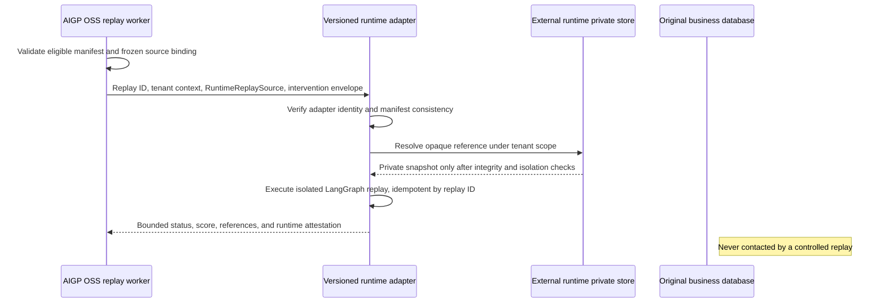

# Runtime Replay Adapter Contract

## Ownership

An external runtime owns private snapshots, their integrity checks, replay
execution, isolation, and any recovery required by its own systems. AI
Governance Control Plane OSS owns only replay eligibility, frozen governance
evidence, replay lifecycle, and lineage. It is never the transaction
coordinator for an external application and it must not execute, retry, or
roll back a business mutation.

`RuntimeReplaySource/v1` is a reference-only Plugin API envelope for a
governed runtime replay. It binds the AIGP replay job to the observed runtime
execution without transferring snapshot contents. Its manifest hash proves
that the invocation is consistent with the frozen AIGP manifest; it is not
proof that the runtime's private snapshot is truthful or still available.

## Envelope Invariants

The envelope contains only:

- source AIGP and external execution identities;
- runtime type and exact registered adapter identity/version;
- an opaque runtime-owned replay reference;
- the declared versioned isolation guarantee; and
- the frozen replay manifest hash.

It contains no endpoint, credential, prompt, response, tool arguments,
business payload, or private snapshot. Adapter endpoints and credentials are
deployment-owned configuration. The adapter resolves the opaque reference
inside its own trust boundary.

After a runtime finalizes its evidence, it may request the existing Causal
Audit eligibility endpoint. Its additive `replay_manifest_hash` response lets
the runtime bind an already-captured private snapshot to the final governance
manifest before it starts an audit. No snapshot is uploaded to OSS; the hash
remains a consistency binding, not independent proof of snapshot truth.

`ReplayExecutionContext.runtime_replay_source` is optional so pre-existing
generic Replay adapters continue to work. It is mandatory when the bridge
marks a source as a `RuntimeReplaySource/v1` governed-runtime replay. A missing
or malformed envelope then fails closed before the adapter is invoked.

## Invocation and Verification

Before replaying, the adapter independently verifies tenant binding, exact
adapter identity, private snapshot integrity, and the declared isolation
guarantee. The runtime rejects any mismatch. It must treat `replay_id` as its
idempotency key and must never use the controlled replay path to mutate the
original business system. An adapter's isolation attestation remains a runtime
claim; AIGP records it as bounded evidence rather than independently proving a
mutation or snapshot state.

## Synthetic Migration

Historical Synthetic Runtime sources retain their frozen endpoint in legacy
configuration and continue through the existing validation path. New bridge
sources do not carry an endpoint: the Synthetic adapter uses its approved
worker configuration and the `RuntimeReplaySource/v1` envelope. This lets the
old persisted artifacts remain replayable while making new integrations
provider-neutral.

Adapter discovery is operational availability, not evidence eligibility. A
manifest can be eligible while no worker has the required adapter installed;
the replay job then fails explicitly with an unavailable-adapter error rather
than reclassifying the historical evidence.
