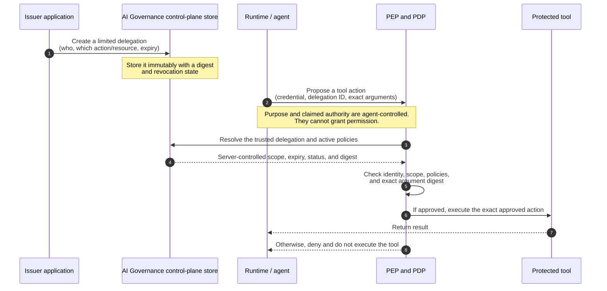

# Runtime Action Authorization

AIGP OSS makes authoritative, deterministic decisions
about individual consequential operations that an external agent runtime wants
to perform. The runtime remains responsible for enforcing the decision before
it invokes the operation.

The authorization endpoint is a decision service. It neither receives a tool
payload nor executes a tool, and it has no dependency on a particular agent
framework.

## Public Contract

Call `POST /api/v1/runtime-action-authorizations/authorize` for one proposed
operation. Hardened requests use the versioned
`runtime-action-authorization/v2` schema and contain:

- an `execution_id` and optional correlation ID;
- a registered `action_id` and bounded resource type/reference;
- an immutable delegation ID, version, and contract digest issued for that
  canonical execution and runtime actor;
- a canonical digest of the exact tool arguments that the PEP will execute;
- at most 32 bounded scalar context facts;
- an idempotency key.

The authenticated server context supplies tenant/project scope and actor or
workload identity. The endpoint rejects caller-supplied tenant and actor
claims. Context must not contain prompts, credentials, reasoning, tool
payloads, or sensitive tool outputs.

For deployments that select scope through request headers, the OSS HTTP client
accepts only the established organisation, project, correlation, request, and
development-mode actor headers through `scope_headers`; credentials remain in
its separate `bearer_token` argument. These headers establish transport scope;
they are never copied into the authorization body as authoritative claims.

Each response returns an `ALLOW` or `DENY`, machine-readable reason code,
the selected policy and the complete evaluated policy ID/version set, decision
and expiry times, delegation bindings, execution/correlation references, and
an immutable request fingerprint. The decision is bound to the exact
execution, actor, action, resource, delegation, tool-argument digest,
idempotency key, and bounded context. It cannot be reused for a different
operation. `policy_id` and `expected_policy_version` remain temporarily
parseable for compatibility, but their presence is denied; a runtime never
selects its approving policy.

### v1 migration

`runtime-action-authorization/v1` has no trusted delegation or tool-argument
binding and is rejected. Before moving a runtime to v2, register the canonical
execution, issue a separately authorized delegation for its explicit scope,
then send its ID/version/digest and the digest computed from the exact tool
arguments. There is no v1 allow fallback.

## Trusted Delegation

Before a runtime may request an operation decision, a separately authorized
application identity creates an immutable delegation with
`POST /api/v1/runtime-action-delegations`. It binds the canonical execution,
tenant scope, issuing identity, runtime actor, explicit action/resource
references, issuance/expiry times, and an immutable digest. Issuance requires
the distinct `runtime_action_delegation.issue` permission and an active
`runtime_action_delegation_issuance` policy; the normal runtime-ingest
permission does not grant it. Repeating the same issuance idempotency key with
the same immutable request returns the original grant; changed content is a
conflict. `POST /api/v1/runtime-action-delegations/{delegation_id}/revoke`
records one-way revocation evidence without editing the grant.

The PDP resolves the delegation from its own tenant-scoped store. Missing,
wrong-version, digest-mismatched, expired, revoked, cross-execution,
cross-actor, out-of-action, and out-of-resource grants deny before policy
evaluation. The runtime cannot create authority by describing a task,
purpose, role, or delegation in `context`.

The AI Governance control plane owns this store. Its agent-execution backend
defaults to SQLite and requires `AI_GOVERNANCE_AGENT_EXECUTION_SQLITE_PATH`;
an operator must explicitly select in-memory or PostgreSQL storage instead.



The PDP never treats agent-provided purpose or authority claims as a source of
permission; they can only make a matched policy more restrictive.

## Policy Convention and Evaluation

Use an existing active AIGP OSS policy definition. Opt it into runtime action
authorization with definition metadata that registers the operation types it
may govern:

```json
{
  "runtime_action_authorization": {
    "purpose": "runtime_action_authorization",
    "registered_actions": ["claims.update"],
    "registered_resource_types": ["sqlite.row"]
  }
}
```

The policy version must target `AgentExecution`. Its normal structured rules
receive server-resolved `action.id`, `resource.type`, `resource.reference`,
`actor.id`, and `delegation.*` facts. `agent_context.*` is bounded advice from
the runtime and can only further restrict through `REJECT` or `BLOCK`; it can
never make an `APPROVE` rule match. Activation rejects new runtime
authorization ALLOW rules that use agent-controlled context, and the PDP
rejects legacy active rules of that form as defense in depth.

The PDP evaluates every active applicable policy registered for the action and
resource type. `APPROVE` allows only when at least one safe policy matches;
`REJECT` and `BLOCK` always override an allow. No match, unsupported effect,
or policy-evaluation error deny.

No registered active policy, unsupported action or resource, no matching rule,
an unsupported policy effect, or a caller policy-selection attempt produces a
`DENY`. Repeating an identical request returns the persisted decision; reusing
its idempotency key with different input produces a conflict.

## Enforcement and Evidence

An integration must request authorization immediately before its protected
operation and execute only a returned, unexpired `ALLOW` whose bindings match
the operation it is about to run. `LangGraphOperationAuthorizer.require_allow`
also receives the digest recomputed from the actual tool arguments and blocks
on a mismatch. A timeout, unavailable service, malformed response, denial,
mismatch, or expired decision must block the operation.

Each decision is appended as `RUNTIME_ACTION_AUTHORIZATION` evidence on the
existing agent execution. The evidence records the decision, actor, action,
resource, policy, reason code, correlation, idempotency identity, and digests
of request/context facts rather than raw context values. A later `TOOL_CALL`
event may cite the decision ID as its causation ID, but it alone records that
the runtime reports a tool invocation actually occurred.

This is necessarily a time-of-check/time-of-use boundary: revocation affects
new authorization decisions immediately, while an already-issued short-lived
ALLOW remains valid only until its expiry. AIGP cannot prove an external
runtime used its integration, nor can it guarantee the protected resource
remains unchanged after a decision. A bypassed enforcement boundary is outside
the control plane's authority.

## Framework Integrations

Framework adapters should remain thin and retain ownership of their own
execution lifecycle. See [LangGraph Runtime Action Authorization](langgraph-runtime-action-authorization.md)
for a fail-closed LangGraph tool-wrapper example.
